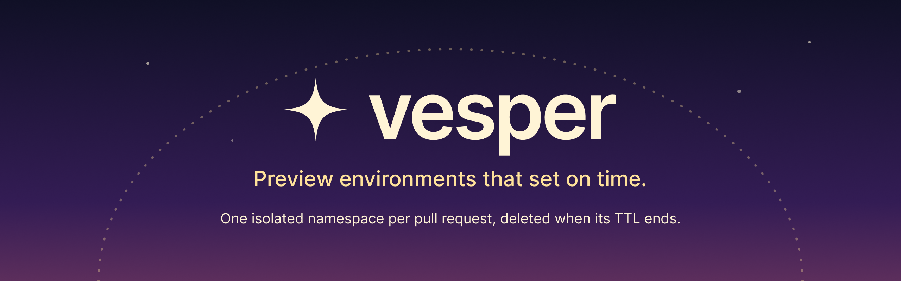
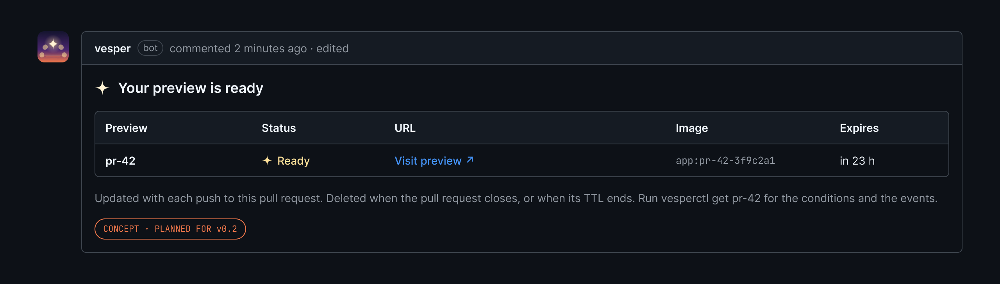
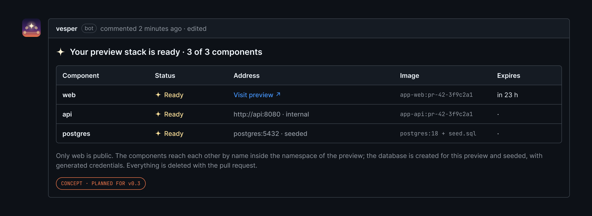
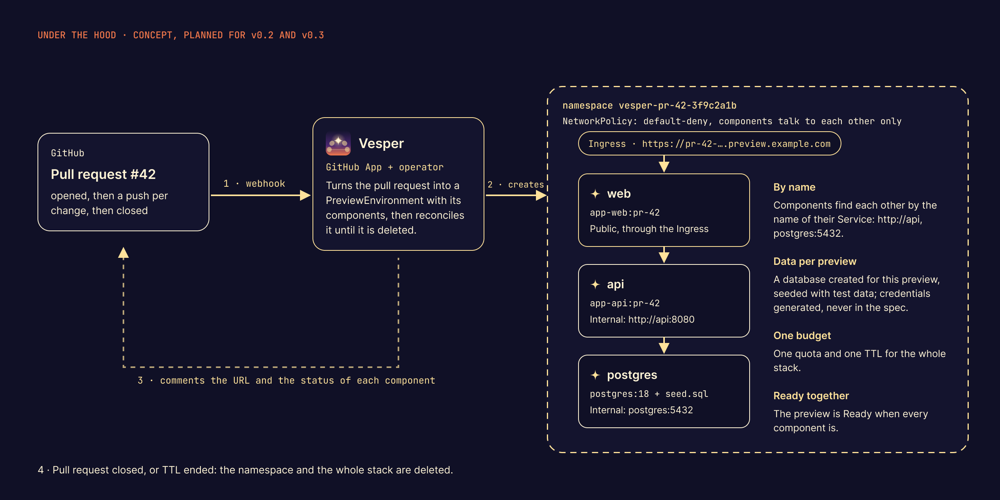

<p align="center">
  
</p>

<p align="center">
  <a href="https://github.com/eventide-oss/vesper/actions/workflows/ci.yml"></a>
  <a href="https://github.com/eventide-oss/vesper/releases/latest"></a>
  <a href="LICENSE"></a>
  <a href="go.mod"></a>
</p>

Vesper gives each pull request its own preview environment on Kubernetes: a
running copy of your application at that version, with its own URL, isolated
from the others, and deleted automatically when its time to live (TTL) ends.
It is an operator that runs in your cluster, and a CLI, `vesperctl`.

**[Quickstart](docs/quickstart.md)** · **[Documentation](https://eventide-oss.github.io/vesper/)** ·
**[Security model](docs/security.md)** · **[Contributing](CONTRIBUTING.md)**

## How it works

<p align="center">
  
</p>

Vesper does not build images: your CI builds one per pull request, and a
`PreviewEnvironment` points at it. The operator watches these objects and does
the rest. The [architecture](docs/architecture.md) goes through it step by
step.

## Quickstart

On a local [kind](https://kind.sigs.k8s.io/) cluster:

```sh
kind create cluster --name vesper
kubectl apply -f https://github.com/eventide-oss/vesper/releases/download/v0.1.0/install.yaml
kubectl -n vesper-system rollout status deploy/vesper-controller-manager

# install vesperctl from the release: see the quickstart, step 3
vesperctl create demo --image nginxinc/nginx-unprivileged:1.27-alpine --port 8080 --ttl 2h
vesperctl get demo      # phase, URL, expiry, conditions and events
```

The [quickstart](docs/quickstart.md) walks through it, from installing
`vesperctl` to opening the preview in a browser, in about ten minutes. On a
real server, with a domain and HTTPS: [try Vesper on a server](docs/try-on-a-server.md).

## Why Vesper

Before a pull request is merged, people want to see the change running. A
shared staging environment gets crowded, and running the branch on a laptop is
not open to everyone. A preview per pull request solves both, as long as it is
isolated and does not stay forever.

- **Isolated by default.** Each preview gets a namespace with the restricted
  Pod Security profile, a ResourceQuota, a LimitRange and a default-deny
  NetworkPolicy. A namespace is a soft boundary, though: the
  [security model](docs/security.md) says what Vesper protects against, and
  what it does not.
- **Gone on time.** A TTL from 1 minute to 7 days; when it ends, the namespace
  and everything in it is deleted. No orphans.
- **Easy to follow.** `vesperctl list` and `vesperctl get` show the phase, the
  URL, the expiry, the conditions and the events. Prometheus metrics included.
- **Verifiable.** Releases ship checksums and build provenance attestations;
  the image runs as a non-root user and is pinned by digest.

## Documentation

- [Quickstart](docs/quickstart.md), on kind, and [Try Vesper on a server](docs/try-on-a-server.md),
  with k3s, a domain and HTTPS
- [Cheat sheet](docs/cheatsheet.md): the everyday commands
- [vesperctl reference](docs/cli.md) and [CRD reference](docs/crd-reference.md)
- [Architecture](docs/architecture.md) and the [decision records](docs/adr/)
- [Security model](docs/security.md) and [metrics](docs/metrics.md)
- [Development](docs/development.md): build and run Vesper from source

All the guides are listed in [docs/](docs/README.md), and published on the
[documentation site](https://eventide-oss.github.io/vesper/).

## Where we're going

Today you create a preview yourself, and it runs one application. Two steps
take Vesper to a preview of the whole pull request, opened and closed on its
own.

### v0.2 · From a pull request to a preview

A GitHub App receives the events of the pull request: the preview opens with
it, follows each push, and closes with it. Vesper posts the URL on the pull
request, like this:

<p align="center">
  
</p>

### v0.3 · A whole stack per preview

Testing a change end to end needs more than one image. A preview will run
several components side by side, a frontend, an API and a database seeded
with test data, in the namespace of the preview, so the pull request is tested
as it will run.

<p align="center">
  
</p>

How it will work under the hood:

<p align="center">
  
</p>

These are concepts. The GitHub integration is planned in the
[v0.2 milestone](https://github.com/eventide-oss/vesper/milestone/6); the
multi-service previews in the [v0.3 milestone](https://github.com/eventide-oss/vesper/milestone/7),
whose design starts with [#162](https://github.com/eventide-oss/vesper/issues/162):
the shape of the API is not decided yet.

- **v0.2, GitHub integration.** Previews from pull requests, private images,
  protected preview URLs.
- **v0.3, multi-service previews.** Several components and a seeded database
  per preview.
- **Later, ideas rather than promises.** Policies per team, other forges such
  as GitLab, previews that sleep when nobody uses them, the OpenSSF Best
  Practices badge and an application to the CNCF Sandbox.

## Status

[v0.1.0](https://github.com/eventide-oss/vesper/releases/tag/v0.1.0) is the
first release. The API is `v1alpha1` and may change before v1.0. What v0.1
covers, and how it was checked, is in the [acceptance of v0.1](docs/acceptance-v0.1.md).

## Contributing

Contributions are welcome. Read [CONTRIBUTING.md](CONTRIBUTING.md) first, and
pick one of the [good first issues](https://github.com/eventide-oss/vesper/labels/good%20first%20issue).
The project follows a [Code of Conduct](CODE_OF_CONDUCT.md) and a simple
[governance](GOVERNANCE.md). Every change starts from an issue and ends in a
small pull request that follows [the template](.github/PULL_REQUEST_TEMPLATE.md).
AI agents also read [AGENTS.md](AGENTS.md).

If Vesper is useful to you, a star helps others find it.

## License

[Apache-2.0](LICENSE). The name and the logo of Vesper are described in the
[brand guide](docs/brand.md).
