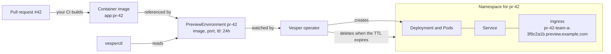

# Vesper

Ephemeral preview environments for Kubernetes, one per pull request.

Vesper is a Kubernetes operator and a CLI (`vesperctl`). You declare a
`PreviewEnvironment`; Vesper creates an isolated environment for it, and
removes it automatically when its time to live (TTL) expires.

> **Status:** pre-alpha. The `PreviewEnvironment` API and the read-only CLI
> work today, and the operator runs each preview's image in its own namespace,
> gives it a public address and deletes it when its TTL expires.
> See [Status](#status).

## Why

Before a pull request is merged, people want to see the change running: a
designer clicks through it, a tester tries it, a product owner signs it off.
Running the branch on a laptop is slow and not open to everyone, and a shared
staging environment gets crowded as pull requests overwrite each other.

A preview environment is a temporary copy of the application at the version of
one pull request, with its own address:

```text
pull request #42  ->  https://pr-42.preview.example.com
pull request #57  ->  https://pr-57.preview.example.com
```

Each preview is isolated from the others, and it is deleted when its TTL
expires (for example after 24 hours), so it does not use the cluster forever.

## How it works

This is how Vesper works today.



1. A pull request changes the application.
2. The project's own CI builds a container image of that version. Building
   images is not Vesper's job: Vesper receives an image that already exists.
3. A `PreviewEnvironment` object asks for a preview: which image, which port,
   how long it lives. It is a plain record stored by the Kubernetes API server,
   defined by a custom resource definition (CRD).
4. The Vesper operator, a program that runs in the cluster, watches these
   objects and makes them real.
5. For each one it creates a namespace with a Deployment (which runs the Pods),
   a Service and an Ingress that gives the preview its address.
6. People open the address and try the change.
7. When the TTL expires, the operator deletes the namespace and everything in
   it.

`vesperctl` creates, reads and extends these objects from the command line,
and will later delete them.

## Status

Works today:

- The `PreviewEnvironment` API: a CRD generated from Go types, with validation
  and defaults applied by the API server (the image must be pinned with a tag
  other than `latest` or with a digest) and a status that only the operator can
  write. `kubectl get pe` shows the phase, the URL and the expiry.
- The operator runs each preview in its own namespace, with the restricted Pod
  Security profile, bounded resources (a LimitRange and a ResourceQuota,
  configurable by operator flags) and a NetworkPolicy that keeps it apart from
  other previews and from the rest of the cluster: a Deployment of its image,
  port, environment and replicas, behind a Service that gives it a stable
  address inside the cluster. Images must run as a non-root user.
- `kubectl describe pe` tells what happens to a preview: its phase, the
  conditions `Ready`, `Available` and `Expired` with a reason (for example
  `PodsRejected` when its quota is full), and events for each change.
- With a preview domain configured, each preview gets a public address, such
  as `http://pr-42-team-a-3f9c2a1b.preview.example.com`, through an Ingress
  served by the ingress controller of the cluster (Traefik, HAProxy...), and
  written to `status.url`. HTTPS is not supported yet.
- Previews expire: when its `ttl` has passed (1 minute to 7 days, 24 hours by
  default), a preview is deleted, and deleting a preview deletes its namespace
  and everything in it. `vesperctl extend` raises the `ttl` to extend it.
- `vesperctl create` creates a preview environment from flags (or prints it as
  YAML with `--dry-run`) and `vesperctl extend` extends one; `vesperctl list`
  and `vesperctl get` read them, as a table or as JSON or YAML, with clear
  error messages and documented exit codes. See the [vesperctl reference](docs/cli.md).
- Shell completion for bash, zsh and fish.
- Integration tests of the CLI against a kind cluster.

Not yet:

| Piece | Milestone |
| --- | --- |
| HTTPS, metrics, `vesperctl delete` | [P3 - Lifecycle and hardening](https://github.com/eventide-oss/vesper/milestone/4) |
| Install bundle, quickstart and the v0.1.0 release | [P4 - Release v0.1](https://github.com/eventide-oss/vesper/milestone/5) |
| A pull request creates its preview automatically (GitHub integration) | after v0.1 |

## Try it locally

Once it runs, the [cheat sheet](docs/cheatsheet.md) lists the everyday
commands: create, follow, open, debug, extend and delete a preview.

This walkthrough runs Vesper on a local [kind](https://kind.sigs.k8s.io/)
cluster and deploys one preview. You need Go, Docker, kind and kubectl; see
[Development](docs/development.md#prerequisites).

Vesper has two parts, and both must be in place before a preview does
anything:

- **The API** (the CRD): it teaches the cluster the `PreviewEnvironment` type,
  so it can store and validate previews. On its own, a stored preview is only
  a record: nothing runs.
- **The operator**: the program that watches previews and creates their
  namespace, Deployment and Service, then writes their status. For now you run
  it on your machine with `make run`; an in-cluster install comes later.

Use `kubectl` to create, change and delete previews, as for any Kubernetes
object. Use `vesperctl` to read them in a friendlier way; it will also create
and delete them later.

**1. Build the binaries.** `bin/vesperctl` is the CLI, `bin/manager` the
operator.

```sh
make build
./bin/vesperctl version
```

**2. Create a local cluster and select it.** Every `kubectl` command, and the
operator, act on the cluster of the current context.

```sh
make kind-up
kubectl config use-context kind-vesper-dev
```

**3. Install the API.** The cluster now knows the `PreviewEnvironment` type
(short name `pe`).

```sh
make install
kubectl get crd previewenvironments.vesper.eventide.dev
```

**4. Run the operator, in a second terminal.** It stays in the foreground and
logs what it does; leave it running. Stop it with Ctrl-C.

```sh
make run
```

**5. Create a preview** from the sample: an unprivileged nginx image, kept
for 24 hours.

```sh
kubectl apply -f config/samples/vesper_v1alpha1_previewenvironment.yaml
```

**6. Watch it become `Ready`.** The phase goes from `Pending` to `Ready` once
its pod runs, usually within a minute while the image downloads. Stop
`kubectl get -w` with Ctrl-C.

```sh
kubectl get pe -w
./bin/vesperctl list -A
./bin/vesperctl get previewenvironment-sample
```

**7. Look inside it.** Each preview has a namespace of its own, which carries
the name of the preview in a label. It holds a Deployment named `app`, its
pod, and a Service named `app`.

```sh
NS=$(kubectl get ns -l vesper.eventide.dev/preview-name=previewenvironment-sample \
  -o jsonpath='{.items[0].metadata.name}')
kubectl get deploy,pods,svc -n "$NS"
```

**8. Open it.** This local cluster has no ingress controller and the operator
runs without a preview domain, so the preview has no public address, only an
address inside the cluster (`kubectl get pe -o wide` shows it). Forward a
local port to its Service, then open <http://localhost:8080> in a browser. To
give previews a public address, see
[Public address](docs/development.md#public-address).

```sh
kubectl port-forward -n "$NS" svc/app 8080:80
```

**9. Clean up.** Delete the preview while the operator still runs: it
deletes the preview namespace first, and `kubectl delete` returns once both
are gone. Then stop the operator (Ctrl-C), and remove the API or the whole
cluster.

```sh
kubectl delete -f config/samples/vesper_v1alpha1_previewenvironment.yaml
kubectl get ns "$NS"   # NotFound: the namespace is gone too
make uninstall         # removes the CRD (delete the previews first, see below)
make kind-down         # or delete the whole cluster
```

A deleted preview waits for the operator to clean it up. If the operator is
stopped, `kubectl delete` and `make uninstall` wait too: see
[Delete a preview](docs/development.md#delete-a-preview).

What the operator does, and why, is described in
[Development](docs/development.md#what-the-operator-does).

## Contributing

Contributions are welcome. Read [CONTRIBUTING.md](CONTRIBUTING.md) first; the
project follows a [Code of Conduct](CODE_OF_CONDUCT.md) and a simple
[governance](GOVERNANCE.md). In short: every change starts from an issue, uses a
`<type>/<issue-number>-<description>` branch and Conventional Commits, and ends
in a small pull request that follows
[the template](.github/PULL_REQUEST_TEMPLATE.md). AI agents also read
[AGENTS.md](AGENTS.md).

## License

Apache-2.0.
