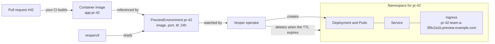

# Vesper

[](https://github.com/eventide-oss/vesper/actions/workflows/ci.yml)
[](https://github.com/eventide-oss/vesper/releases)
[](LICENSE)

Ephemeral preview environments for Kubernetes, one per pull request.

Vesper is a Kubernetes operator and a CLI (`vesperctl`). You declare a
`PreviewEnvironment`; Vesper creates an isolated environment for it, and
removes it automatically when its time to live (TTL) expires.

> **Status:** release candidate. [v0.1.0-rc.2](https://github.com/eventide-oss/vesper/releases)
> installs from one manifest: the operator runs each preview in a namespace
> of its own, gives it a public address, over HTTPS if you want, and deletes
> it when its TTL expires; `vesperctl` creates, follows, extends and deletes
> previews. Try it with the [quickstart](docs/quickstart.md). See [Status](#status).

## Why

Before a pull request is merged, people want to see the change running: a
designer clicks through it, a tester tries it, a product owner signs it off.
Running the branch on a laptop is slow and not open to everyone, and a shared
staging environment gets crowded as pull requests overwrite each other.

A preview environment is a temporary copy of the application at the version of
one pull request, with its own address:

```text
pull request #42  ->  https://pr-42.preview.example.com
pull request #57  ->  https://pr-57.preview.example.com
```

Each preview is isolated from the others, and it is deleted when its TTL
expires (for example after 24 hours), so it does not use the cluster forever.
A namespace is a soft boundary, though: the [security model](docs/security.md)
says what Vesper protects against, and what it does not.

## How it works

This is how Vesper works today.



1. A pull request changes the application.
2. The project's own CI builds a container image of that version. Building
   images is not Vesper's job: Vesper receives an image that already exists.
3. A `PreviewEnvironment` object asks for a preview: which image, which port,
   how long it lives. It is a plain record stored by the Kubernetes API server,
   defined by a custom resource definition (CRD).
4. The Vesper operator, a program that runs in the cluster, watches these
   objects and makes them real.
5. For each one it creates a namespace with a Deployment (which runs the Pods),
   a Service and an Ingress that gives the preview its address.
6. People open the address and try the change.
7. When the TTL expires, the operator deletes the namespace and everything in
   it.

`vesperctl` creates, reads, extends and deletes these objects from the
command line.

## Status

Works today:

- The `PreviewEnvironment` API: a CRD generated from Go types, with validation
  and defaults applied by the API server (the image must be pinned with a tag
  other than `latest` or with a digest) and a status that only the operator can
  write. `kubectl get pe` shows the phase, the URL and the expiry.
- The operator runs each preview in its own namespace, with the restricted Pod
  Security profile, bounded resources (a LimitRange and a ResourceQuota,
  configurable by operator flags) and a NetworkPolicy that keeps it apart from
  other previews and from the rest of the cluster: a Deployment of its image,
  port, environment and replicas, behind a Service that gives it a stable
  address inside the cluster. Images must run as a non-root user.
- `kubectl describe pe` tells what happens to a preview: its phase, the
  conditions `Ready`, `Available` and `Expired` with a reason (for example
  `PodsRejected` when its quota is full), and events for each change.
- With a preview domain configured, each preview gets a public address, such
  as `http://pr-42-team-a-3f9c2a1b.preview.example.com`, through an Ingress
  served by the ingress controller of the cluster (Traefik, HAProxy...), and
  written to `status.url`; with `--preview-tls`, over HTTPS, with a wildcard
  certificate the ingress controller serves.
- Previews expire: when its `ttl` has passed (1 minute to 7 days, 24 hours by
  default), a preview is deleted, and deleting a preview deletes its namespace
  and everything in it. `vesperctl extend` raises the `ttl` to extend it.
- `vesperctl create` creates a preview environment from flags (or prints it as
  YAML with `--dry-run`), `vesperctl extend` extends one and
  `vesperctl delete` deletes one, after a confirmation; `vesperctl list`
  and `vesperctl get` read them, as a table or as JSON or YAML, with clear
  error messages and documented exit codes. See the [vesperctl reference](docs/cli.md).
- Shell completion for bash, zsh and fish.
- Prometheus metrics: the previews per phase and the expiries, with those of
  controller-runtime. See [## Try it

- **[Quickstart](docs/quickstart.md)**: a kind cluster, the operator from a
  release, a preview opened in your browser, in about ten minutes.
- **[Try Vesper on a server](docs/try-on-a-server.md)**: k3s on a VPS, a real
  domain and HTTPS.
- **[Cheat sheet](docs/cheatsheet.md)**: the everyday commands, to create,
  follow, open, debug, extend and delete a preview.
- **From source**, to work on Vesper: [Development](docs/development.md#walkthrough-from-source).

To understand how it works, read the [architecture](docs/architecture.md); to
know what it protects against, the [security model](docs/security.md).

** Delete the preview while the operator still runs: it
deletes the preview namespace first, and `kubectl delete` returns once both
are gone. Then stop the operator (Ctrl-C), and remove the API or the whole
cluster.

```sh
kubectl delete -f config/samples/vesper_v1alpha1_previewenvironment.yaml
kubectl get ns "$NS"   # NotFound: the namespace is gone too
make uninstall         # removes the CRD (delete the previews first, see below)
make kind-down         # or delete the whole cluster
```

A deleted preview waits for the operator to clean it up. If the operator is
stopped, `kubectl delete` and `make uninstall` wait too: see
[Delete a preview](docs/development.md#delete-a-preview).

What the operator does, and why, is described in
[Development](docs/development.md#what-the-operator-does).

## Contributing

Contributions are welcome. Read [CONTRIBUTING.md](CONTRIBUTING.md) first; the
project follows a [Code of Conduct](CODE_OF_CONDUCT.md) and a simple
[governance](GOVERNANCE.md). In short: every change starts from an issue, uses a
`<type>/<issue-number>-<description>` branch and Conventional Commits, and ends
in a small pull request that follows
[the template](.github/PULL_REQUEST_TEMPLATE.md). AI agents also read
[AGENTS.md](AGENTS.md).

## License

Apache-2.0.
