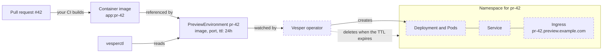

# Vesper

Ephemeral preview environments for Kubernetes, one per pull request.

Vesper is a Kubernetes operator and a CLI (`vesperctl`). You declare a
`PreviewEnvironment`; Vesper creates an isolated environment for it, and
removes it automatically when its time to live (TTL) expires.

> **Status:** pre-alpha. The `PreviewEnvironment` API and the read-only CLI
> work today; the operator that creates environments does not exist yet. See
> [Status](#status).

## Why

Before a pull request is merged, people want to see the change running: a
designer clicks through it, a tester tries it, a product owner signs it off.
Running the branch on a laptop is slow and not open to everyone, and a shared
staging environment gets crowded as pull requests overwrite each other.

A preview environment is a temporary copy of the application at the version of
one pull request, with its own address:

```text
pull request #42  ->  https://pr-42.preview.example.com
pull request #57  ->  https://pr-57.preview.example.com
```

Each preview is isolated from the others, and it is deleted when its TTL
expires (for example after 24 hours), so it does not use the cluster forever.

## How it works

This is the target design. Dashed boxes are not built yet.



1. A pull request changes the application.
2. The project's own CI builds a container image of that version. Building
   images is not Vesper's job: Vesper receives an image that already exists.
3. A `PreviewEnvironment` object asks for a preview: which image, which port,
   how long it lives. It is a plain record stored by the Kubernetes API server,
   defined by a custom resource definition (CRD).
4. The Vesper operator, a program that runs in the cluster, watches these
   objects and makes them real.
5. For each one it creates a namespace with a Deployment (which runs the Pods),
   a Service and an Ingress that gives the preview its address.
6. People open the address and try the change.
7. When the TTL expires, the operator deletes the namespace and everything in
   it.

`vesperctl` reads these objects from the command line, and will later create,
extend and delete them.

## Status

Works today:

- The `PreviewEnvironment` API: a CRD generated from Go types, with validation
  and defaults applied by the API server (the image must be pinned with a tag
  other than `latest` or with a digest) and a status that only the operator can
  write. `kubectl get pe` shows the phase, the URL and the expiry.
- `vesperctl list` and `vesperctl get`: read preview environments, as a table
  or as JSON or YAML, with clear error messages and documented exit codes. See
  the [vesperctl reference](docs/cli.md).
- Shell completion for bash, zsh and fish.
- Integration tests of the CLI against a kind cluster.

Not yet:

| Piece | Milestone |
| --- | --- |
| The operator: namespace, Deployment, Service | [P2 - Operator core](https://github.com/eventide-oss/vesper/milestone/3) |
| Ingress address, TTL expiry, clean deletion, quotas, security defaults, `vesperctl create`, `extend` and `delete` | [P3 - Lifecycle and hardening](https://github.com/eventide-oss/vesper/milestone/4) |
| Install bundle, quickstart and the v0.1.0 release | [P4 - Release v0.1](https://github.com/eventide-oss/vesper/milestone/5) |
| A pull request creates its preview automatically (GitHub integration) | after v0.1 |

## Try the CLI

You need Go, Docker and [kind](https://kind.sigs.k8s.io/); see
[Development](docs/development.md).

```sh
make build
./bin/vesperctl version

# A local cluster with the PreviewEnvironment CRD and a sample preview:
make kind-up
kubectl config use-context kind-vesper-dev
make install
kubectl apply -f config/samples/vesper_v1alpha1_previewenvironment.yaml
./bin/vesperctl list -A
kubectl get pe -A
```

The API server validates the preview and fills its defaults. Nothing runs for
it yet: its phase stays empty until the operator exists. `make uninstall`
removes the CRD and every `PreviewEnvironment` with it.

## Contributing

Contributions are welcome. Read [CONTRIBUTING.md](CONTRIBUTING.md) first; the
project follows a [Code of Conduct](CODE_OF_CONDUCT.md) and a simple
[governance](GOVERNANCE.md). In short: every change starts from an issue, uses a
`<type>/<issue-number>-<description>` branch and Conventional Commits, and ends
in a small pull request that follows
[the template](.github/PULL_REQUEST_TEMPLATE.md). AI agents also read
[AGENTS.md](AGENTS.md).

## License

Apache-2.0.
