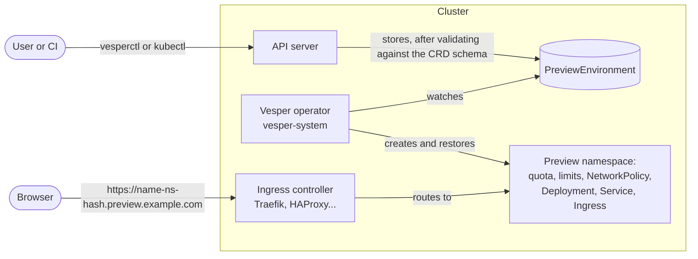
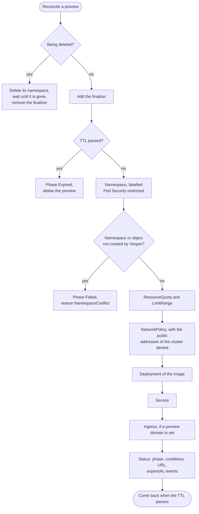
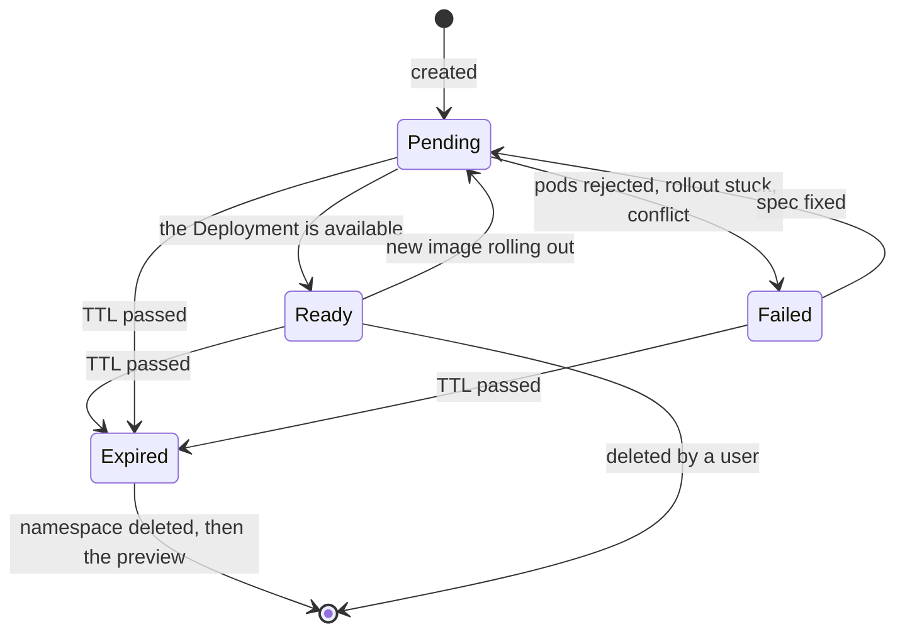

# Architecture

Vesper is a Kubernetes operator and a CLI. This page shows how the pieces fit
and what happens to a preview from its creation to its deletion. The fields of
the API are in the [CRD reference](crd-reference.md); the reasons behind the
choices are in the [ADRs](adr/).

## The pieces

- **The CRD** (`config/crd/bases`) adds the `PreviewEnvironment` kind to the
  API server. Its schema validates every write, even when the operator does
  not run: an image pinned by tag or digest, a TTL between 1 minute and 7
  days, at most 5 replicas.
- **The operator** (`cmd/main.go`, `internal/controller`) watches previews
  and the objects it created for them, and makes the cluster match each
  preview. It writes the status of the preview.
- **`vesperctl`** (`cmd/vesperctl`) talks to the API server, like `kubectl`:
  it creates, reads, extends and deletes previews. It never talks to the
  operator.
- **The ingress controller** of the cluster serves the public address of
  each preview, when the operator runs with `--preview-domain`.

Previews live in the namespaces of their users; each one runs in a namespace
of its own ([ADR-0002](adr/0002-namespace-per-preview.md),
[ADR-0003](adr/0003-namespaced-preview-environment.md)), named after the
namespace and name of the preview with a hash, for example
`vesper-team-a-pr-42-3f9c2a1b`. The operator tracks the objects of a preview by
labels, since an owner reference cannot point to another namespace.

## A reconciliation

The operator reconciles a preview when its spec changes, when an object it
created for it changes or is deleted, when its TTL passes, and when the
addresses of the nodes or of the API server change. Each reconciliation runs
the same steps, from the top, and is safe to repeat:

- **Order matters for security.** The quota, the LimitRange and the
  NetworkPolicy exist before the Deployment, so no pod of a preview runs
  without them; if one of them fails, the Deployment is not created
  ([security model](security.md)).
- **Restore, do not trust.** Every step compares the object with what it
  should be, and writes it back if it was changed by hand. An object that
  already matches is not written, so a reconciliation that changes nothing
  writes nothing.
- **Errors stop the run.** The first step that fails ends the
  reconciliation: the status says why (`ReconcileError`), and
  controller-runtime retries with a growing delay.
- **No polling for the TTL.** The operator asks to be called back when the
  TTL passes ([ADR-0004](adr/0004-ttl-semantics.md)); changing the TTL
  reconciles the preview and sets a new delay.

## The life of a preview

The phase sums the state up; the conditions `Ready`, `Available` and
`Expired` hold the details, with a reason and a message, and the operator
records an event at each change. `vesperctl get` shows them.

**Deletion goes through a finalizer** (`vesper.eventide.dev/cleanup`). When a
preview is deleted, by a user or because its TTL passed, the API server keeps
it until the operator removes the finalizer: the operator first deletes the
preview namespace, which deletes everything in it, and waits until it is
gone. A preview is never removed while its namespace remains.

## Where to read the code

| Concern | File |
| --- | --- |
| The API types and their validation | `api/v1alpha1/previewenvironment_types.go` |
| The reconciliation, the watches | `internal/controller/previewenvironment_controller.go` |
| Names of namespaces and hosts | `internal/controller/naming.go` |
| Quota and limits | `internal/controller/quota.go` |
| Network isolation | `internal/controller/networkpolicy.go`, `hostaddresses.go` |
| Deployment, Service, Ingress | `deployment.go`, `service.go`, `ingress.go` |
| TTL and deletion | `ttl.go`, `finalizer.go` |
| Status, conditions and events | `status.go` |
| Metrics | `metrics.go` |
| The operator flags | `cmd/main.go` |
| The CLI | `cmd/vesperctl` |
